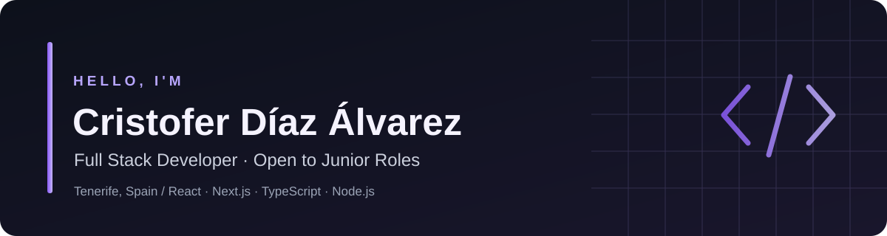

### Full Stack Developer · Open to Junior Opportunities

Building useful web applications, from interface to database.

📍 **Tenerife, Spain** · Open to junior roles in Tenerife or remote from Spain

---

### 👋 About me

I'm a **junior full stack developer** based in Tenerife, Spain. I enjoy designing accessible interfaces, building APIs and working with databases. I learn by creating complete applications, testing them and documenting the decisions behind them.

I'm currently seeking my **first professional opportunity** in frontend or full stack development.

*¡Hola! Soy Cristofer, desarrollador web junior. Puedes explorar mis proyectos y sus casos de estudio en [mi portfolio en español](https://developer-portfolio-plum-mu.vercel.app/es).*

### ✦ Selected work

<table>
<tr><td width="50%" valign="top">

**🏢 BusinessOS — ERP**

Business management demo covering customers, inventory, orders, invoices and role-based access.

**Stack:** Next.js · NestJS · TypeScript · PostgreSQL · Prisma

[**Live demo**](https://businessos-web-five.vercel.app) · [**Repository**](https://github.com/cristoferdiazalvarez/businessos-erp)

</td><td width="50%" valign="top">

**🛍️ Atelier Commerce — E-commerce**

Editorial fashion storefront with product variants, stock management, accounts and a simulated checkout.

**Stack:** Next.js · React · TypeScript · PostgreSQL · Prisma

[**Live demo**](https://atelier-commerce-two.vercel.app) · [**Repository**](https://github.com/cristoferdiazalvarez/atelier-commerce)

</td></tr>
<tr><td colspan="2" valign="top">

**🌐 Developer Portfolio**

Bilingual responsive website with project case studies, accessibility considerations and automated tests.

**Stack:** Next.js · React · TypeScript · Playwright

[**Live website**](https://developer-portfolio-plum-mu.vercel.app) · [**Repository**](https://github.com/cristoferdiazalvarez/developer-portfolio)

</td></tr>
</table>

### 🧰 Technologies

**Frontend** · HTML · CSS · JavaScript · TypeScript · React · Next.js · Tailwind CSS

**Backend & databases** · Node.js · NestJS · PostgreSQL · Prisma

**Tools & testing** · Git · GitHub Actions · Vitest · Playwright

### 🤝 Let's connect

I'm interested in joining a development team, contributing to real products and growing through collaboration.

**[Explore my portfolio](https://developer-portfolio-plum-mu.vercel.app)** · **[Connect on LinkedIn](https://www.linkedin.com/in/cristofer-d%C3%ADaz-%C3%A1lvarez-039a693b8/)**

These are portfolio demonstration projects. Example business data and orders are fictional; Atelier Commerce does not process real payments.
